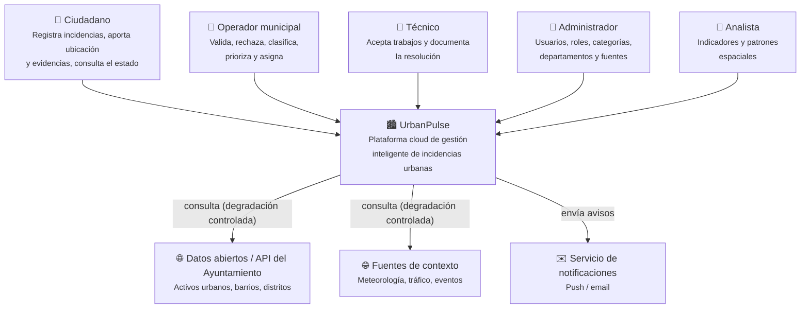
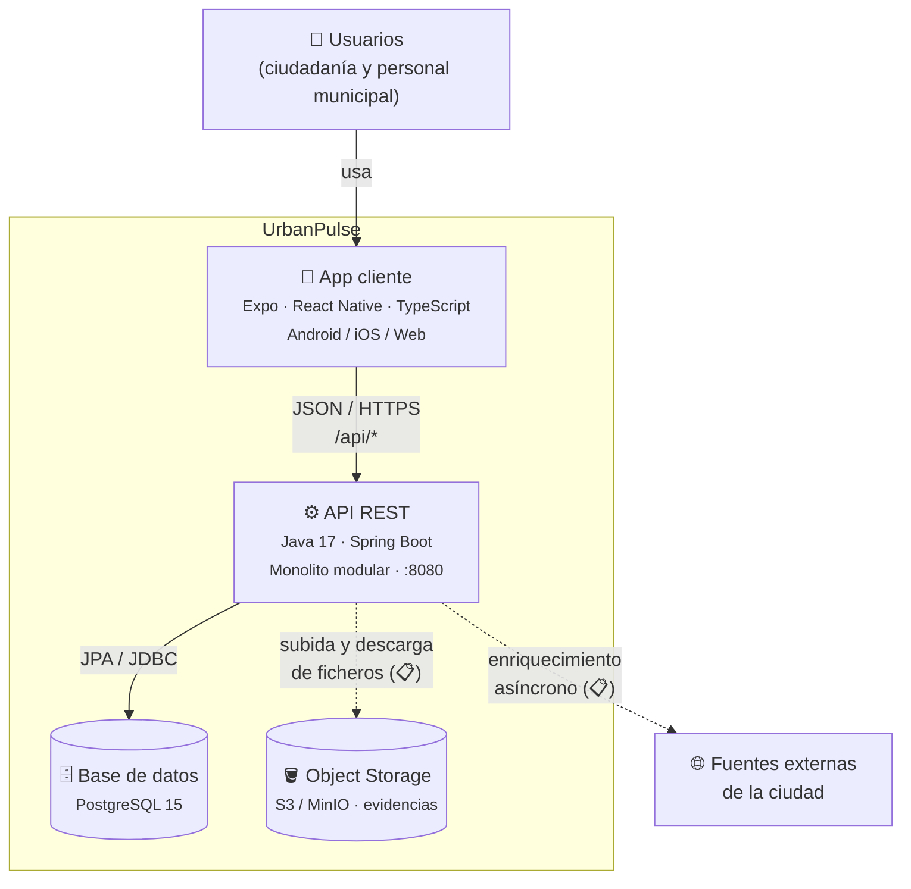
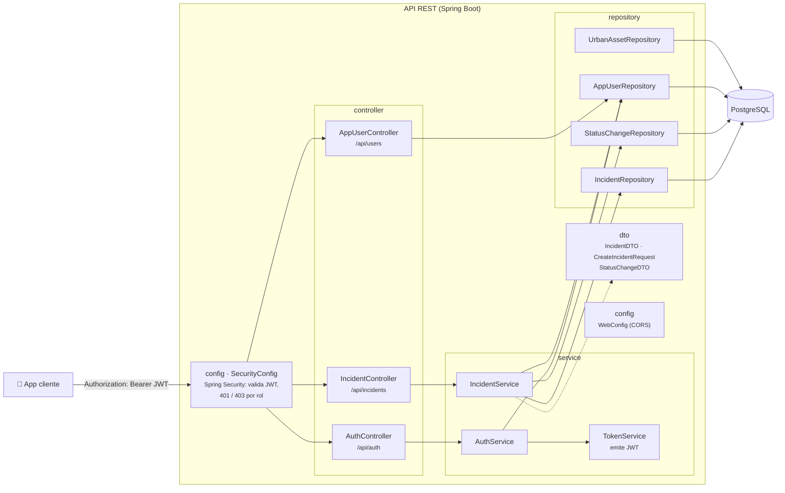
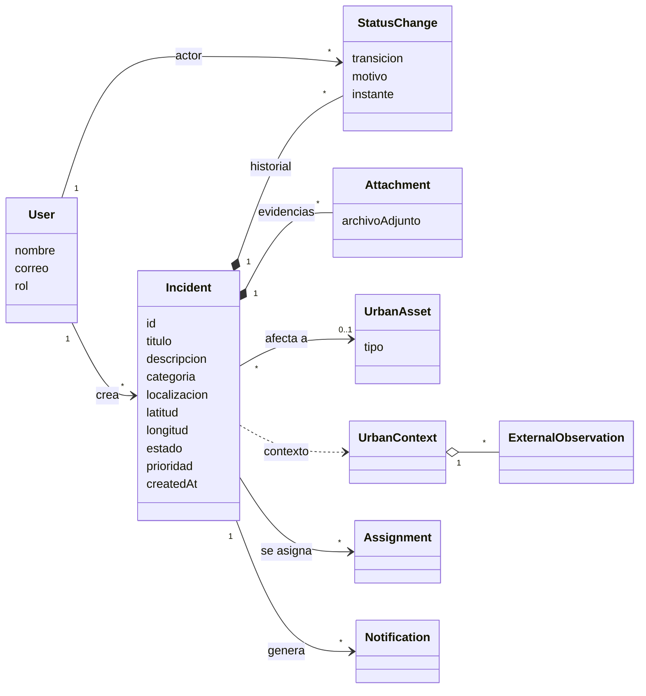
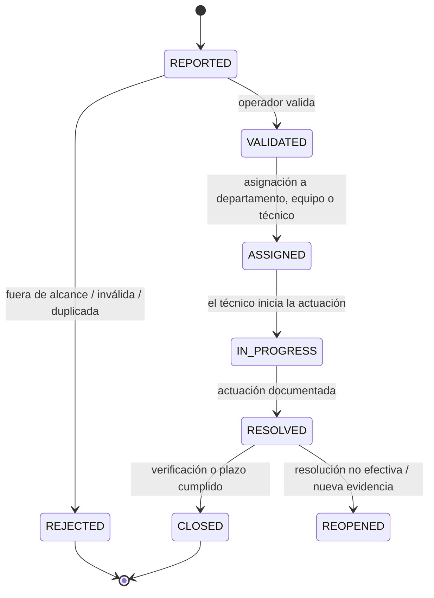

# Arquitectura de UrbanPulse

Este documento describe la arquitectura del sistema con el **modelo C4** (contexto, contenedores y componentes),
el modelo de dominio y el ciclo de vida de la incidencia. Es **documentación viva**: según las pautas del
proyecto, cada cambio relevante actualiza este documento, un [ADR](adr/) y las pruebas asociadas.

> Leyenda de estado: ✅ implementado · 🚧 en curso / parcial · 📋 planificado

---

## 1. Visión general

UrbanPulse es una **aplicación cliente-servidor**:

- Un **monolito modular en Spring Boot** expone una API REST y contiene toda la lógica de negocio
  ([ADR-001](adr/001-monolito-modular-spring-boot.md)).
- **PostgreSQL** es el almacén principal y transaccional ([ADR-002](adr/002-postgresql-persistencia-principal.md)).
- Las evidencias (fotos y ficheros) se guardan en **Object Storage** y en la base de datos solo quedan sus
  metadatos ([ADR-003](adr/003-object-storage-evidencias.md)).
- Las **fuentes externas de la ciudad** enriquecen la incidencia, pero nunca bloquean su creación
  ([ADR-004](adr/004-degradacion-controlada-api-externa.md)).
- Una **app Expo / React Native** (móvil y web) es el cliente de la ciudadanía y del personal municipal
  ([ADR-005](adr/005-cliente-multiplataforma-expo.md)).

Pautas de diseño que guían toda la arquitectura:

1. La **incidencia** es la entidad central del dominio y conserva un ciclo de vida auditable.
2. Los datos externos **enriquecen, nunca bloquean** el reporte.
3. Se elige **la solución más sencilla** que satisfaga los atributos de calidad medidos. Solo se añade un
   componente nuevo cuando hay un problema observable, una hipótesis comprobable y una decisión documentada.

---

## 2. C4 — Nivel 1: Diagrama de contexto



| Actor / sistema | Relación con UrbanPulse | Estado |
|---|---|---|
| Ciudadano | Registra y consulta incidencias desde la app. | 🚧 |
| Operador municipal | Valida, prioriza y asigna incidencias. | 📋 |
| Técnico | Gestiona su cola de trabajo y documenta la resolución. | 📋 |
| Administrador | Configura usuarios, roles y catálogos. | 📋 |
| Analista | Explota indicadores y análisis territoriales. | 📋 |
| Datos del Ayuntamiento / contexto | Aportan contexto urbano. Su caída no impide registrar la incidencia. | 📋 |

---

## 3. C4 — Nivel 2: Diagrama de contenedores



| Contenedor | Tecnología | Responsabilidad | Estado |
|---|---|---|---|
| App cliente | Expo SDK 58, React Native 0.88, Expo Router, react-native-maps, expo-location | Vista principal de mapa con las incidencias (tarjeta al pulsar un marcador y detalle al pulsar la tarjeta), vista de lista, registro y detalle, inicio de sesión y creación de cuenta, con barra lateral de navegación (fija en escritorio, desplegable en móvil) que muestra el usuario y las secciones según su rol. | 🚧 |
| API REST | Spring Boot 4, Spring MVC, Spring Data JPA, Maven | Punto de entrada único, reglas de negocio y ciclo de vida. | 🚧 |
| Base de datos | PostgreSQL 15 | Persistencia del dominio y del historial de cambios de estado. | ✅ |
| Object Storage | S3 / MinIO | Almacenar evidencias binarias fuera de la base de datos relacional. | 📋 |

---

## 4. C4 — Nivel 3: Componentes de la API REST

El backend se organiza actualmente **por capas técnicas** (`controller → service → repository → entity`).
El [ADR-001](adr/001-monolito-modular-spring-boot.md) plantea fronteras por **módulos de negocio** (Gestión, Contexto, Inteligencia). Esa
evolución está pendiente de decidirse en un ADR.



### API expuesta actualmente

| Método | Ruta | Acceso | Descripción | Requisito |
|---|---|---|---|---|
| `POST` | `/api/auth/register` | Público | Crea una cuenta de ciudadano y devuelve su token. | RF01 |
| `POST` | `/api/auth/login` | Público | Inicia sesión y devuelve un JWT. | RF01 |
| `GET` | `/api/auth/me` | Autenticado | Datos y rol del usuario del token. | RF01 |
| `GET` | `/api/incidents` | Público | Listado de incidencias. | RF06 / RF07 (mínimo) |
| `GET` | `/api/incidents/{id}` | Público | Detalle con su historial de cambios de estado. | RF06 |
| `POST` | `/api/incidents` | Autenticado | Registro de una incidencia a nombre del usuario del token. | RF03, RF04 |
| `GET` | `/api/users` | `ADMIN` | Listado de usuarios con su rol (sin contraseñas). | RF02 |

### Autenticación y autorización ([ADR-009](adr/009-autenticacion-autorizacion-jwt.md))

```mermaid
sequenceDiagram
    participant App as App cliente
    participant Sec as Spring Security
    participant API as Controllers
    App->>API: POST /api/auth/login (correo, contraseña)
    API-->>App: JWT firmado (sub = id, rol) + datos del usuario
    App->>Sec: POST /api/incidents · Authorization: Bearer JWT
    Sec->>Sec: valida firma y caducidad; rol → ROLE_<rol>
    alt token válido y rol permitido
        Sec->>API: petición autenticada
        API-->>App: 201 Created
    else sin token o token inválido
        Sec-->>App: 401
    else rol sin permiso
        Sec-->>App: 403
    end
```

- La API no guarda sesiones: cada petición lleva su token (Twelve-Factor, factor VI).
- Los tokens se firman con HMAC-SHA256 y la clave `JWT_SECRET`; caducan a los `JWT_EXPIRATION_MINUTES`.
- Las reglas de acceso están en `SecurityConfig` y, por método, con `@PreAuthorize("hasRole('...')")`.
- En la app, `AuthProvider` (`src/context/auth-context.tsx`) guarda el token (almacén cifrado en móvil,
  `localStorage` en web), lo añade a cada petición desde `src/services/apiClient.ts` y cierra la sesión si la API
  responde 401. Crear una incidencia sin sesión lleva al inicio de sesión.

Cuando la API se estabilice, el contrato se publicará en OpenAPI en `docs/api/openapi.yml`.

---

## 5. Modelo de dominio



| Entidad | Responsabilidad | Estado |
|---|---|---|
| `Incident` | Reporte central: descripción, categoría, localización, prioridad, estado y marcas temporales. | 🚧 |
| `User` (`AppUser`) | Ciudadano o profesional que crea, consulta o modifica según sus permisos. Rol: `CITIZEN`, `OPERATOR`, `TECHNICIAN`, `ADMIN` o `ANALYST`; contraseña con BCrypt. | ✅ |
| `StatusChange` | Transición auditable con actor, instante, motivo y datos asociados. | 🚧 |
| `Attachment` | Evidencia almacenada fuera de la BD relacional y referenciada por metadatos. | 🚧 (solo nombre) |
| `UrbanAsset` | Elemento físico (semáforo, contenedor, parada…) con geometría, fuente y confianza. | 🚧 (solo tipo) |
| `UrbanContext` | Contexto reproducible (clima, tráfico, eventos…) de una incidencia o zona. | 📋 |
| `Assignment` | Relación temporal entre incidencia y departamento, equipo o técnico. | 📋 |
| `ExternalObservation` | Dato normalizado con fuente, instante de observación e ingesta, unidad y calidad. | 📋 |
| `Notification` | Comunicación derivada de un evento y su estado de entrega. | 📋 (tabla creada) |

El esquema físico está en [`backend/src/main/resources/schema.sql`](../backend/src/main/resources/schema.sql).

---

## 6. Ciclo de vida de la incidencia



| Estado | Significado |
|---|---|
| `REPORTED` | Incidencia recibida y pendiente de revisión. |
| `VALIDATED` | Contenido suficiente y competencia municipal confirmada. |
| `REJECTED` | Fuera de alcance, inválida o duplicada, con el motivo registrado. |
| `ASSIGNED` | Asignada a un departamento, equipo o técnico. |
| `IN_PROGRESS` | Hay una actuación en curso. |
| `RESOLVED` | Actuación completada y documentada. |
| `REOPENED` | La resolución no fue efectiva o aparece nueva evidencia. |
| `CLOSED` | Cierre definitivo tras verificación o plazo establecido. |

Cada transición se registra en `StatusChange` (actor, instante y motivo) y nunca se sobrescribe (RF12, RF18).
La forma de implementarlo se propone en [ADR-008](adr/008-ciclo-vida-maquina-estados.md).

---

## 7. Atributos de calidad

| Atributo | Escenario | Táctica |
|---|---|---|
| Disponibilidad del reporte | Una fuente externa cae y el ciudadano sigue pudiendo registrar la incidencia. | Degradación controlada y enriquecimiento asíncrono ([ADR-004](adr/004-degradacion-controlada-api-externa.md)). |
| Trazabilidad / auditoría | Toda transición queda registrada con actor, instante y motivo. | `StatusChange` de solo inserción, en BD ACID ([ADR-002](adr/002-postgresql-persistencia-principal.md)). |
| Rendimiento | Las evidencias no penalizan las consultas ni las copias de seguridad. | Object Storage para binarios ([ADR-003](adr/003-object-storage-evidencias.md)). |
| Mantenibilidad | El equipo puede evolucionar el sistema sin romper otras partes. | Monolito modular con fronteras claras ([ADR-001](adr/001-monolito-modular-spring-boot.md)). |
| Portabilidad | El mismo artefacto funciona en local, CI y nube. | Configuración por variables de entorno ([ADR-007](adr/007-configuracion-por-entorno-twelve-factor.md)) e imagen de contenedor ([ADR-012](adr/012-despliegue-contenedores.md)). |

---

## 8. Decisiones de arquitectura

El registro completo está en [`docs/adr/`](adr/README.md).

| ADR | Decisión | Estado |
|---|---|---|
| [001](adr/001-monolito-modular-spring-boot.md) | Monolito modular con Spring Boot | Accepted |
| [002](adr/002-postgresql-persistencia-principal.md) | PostgreSQL como persistencia principal | Accepted |
| [003](adr/003-object-storage-evidencias.md) | Evidencias en Object Storage | Accepted |
| [004](adr/004-degradacion-controlada-api-externa.md) | Degradación controlada ante fuentes externas | Accepted |
| [005](adr/005-cliente-multiplataforma-expo.md) | Cliente multiplataforma con Expo y React Native | Accepted |
| [006](adr/006-esquema-bd-explicito-sql.md) | Esquema de base de datos explícito en SQL | Accepted |
| [007](adr/007-configuracion-por-entorno-twelve-factor.md) | Configuración por variables de entorno y Docker Compose | Accepted |
| [008](adr/008-ciclo-vida-maquina-estados.md) | Ciclo de vida como máquina de estados | Proposed |
| [009](adr/009-autenticacion-autorizacion-jwt.md) | Autenticación con JWT y roles | Accepted |
| [010](adr/010-representacion-localizacion.md) | Localización como latitud y longitud numéricas | Accepted |
| [011](adr/011-convenciones-api-rest.md) | Convenciones de la API REST | Proposed |
| [012](adr/012-despliegue-contenedores.md) | Despliegue como imagen de contenedor | Proposed |
