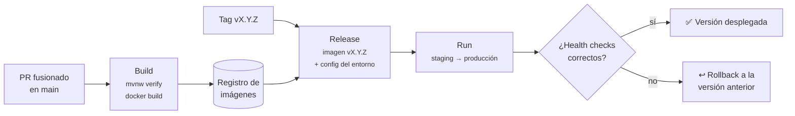

# Guía de despliegue

Este documento describe cómo se construye, configura y despliega UrbanPulse. El despliegue debe ser
**reproducible, automatizado y consistente entre entornos**, siguiendo el factor V de Twelve-Factor
(*Build, release, run*).

> **Estado actual:** ✅ hay integración continua (compilación y pruebas en cada PR). 📋 El empaquetado en
> contenedores y el despliegue en la nube están **pendientes**: la propuesta está en
> [ADR-012](adr/012-despliegue-contenedores.md) y este documento se completará cuando se apruebe. Las secciones marcadas con 📋 describen el proceso previsto.

---

## 1. Entornos

| Entorno | Propósito | Cómo se ejecuta | Estado |
|---|---|---|---|
| `local` | Desarrollo en el equipo de cada miembro. | `compose.yaml` + `mvnw` + Expo ([development.md](development.md)). | ✅ |
| `ci` | Validar cada Pull Request. | GitHub Actions con un servicio PostgreSQL 15. | ✅ |
| `staging` | Probar la release antes de la demo o entrega. | Contenedores en la nube. | 📋 |
| `production` | Entorno de la demo final. | Contenedores en la nube. | 📋 |

Todos los entornos ejecutan **el mismo artefacto**. Solo cambia la configuración, que llega por variables de
entorno.

## 2. Integración continua (✅)

Definida en [`.github/workflows/`](../.github/workflows/). Se ejecuta en cada Pull Request contra `main`:

| Workflow | Qué hace |
|---|---|
| `backend-build.yml` | Levanta PostgreSQL 15, configura Java 17 (Temurin) y ejecuta `mvn clean verify` en `backend/`. |
| `frontend-build.yml` | Configura Node.js 22 e instala las dependencias de `frontend/`. |

Un PR no se fusiona si la CI no está en verde.

## 3. Pipeline previsto: build → release → run (📋)



1. **Build**: la CI compila, prueba y genera la imagen de contenedor del backend.
2. **Release**: la imagen se etiqueta con la versión semántica (`urbanpulse-api:1.2.0`, nunca solo
   `latest`) y se combina con la configuración del entorno.
3. **Run**: el entorno ejecuta esa imagen. **Nunca** se compila, ni se hace `git pull`, ni se instalan
   dependencias a mano en el servidor.

## 4. Construcción manual del artefacto

Mientras no exista el pipeline automático, el artefacto del backend se genera así:

```bash
cd backend
./mvnw clean verify          # compila y ejecuta las pruebas
./mvnw clean package         # genera target/urbanpulse-<versión>.jar
java -jar target/urbanpulse-0.0.1-SNAPSHOT.jar
```

El frontend se publica con EAS (Expo Application Services): `npx eas-cli@latest build` para binarios
móviles y `npx expo export --platform web` para la versión web estática. 📋

## 5. Configuración por entorno

La configuración **no se incluye ni en el código ni en la imagen**. Se inyecta como variables de entorno
(o con el gestor de secretos de la plataforma):

| Variable | Descripción | Secreto |
|---|---|---|
| `SPRING_PROFILES_ACTIVE` | Perfil de Spring (`local`, `staging`, `production`). | No |
| `SPRING_DATASOURCE_URL` | URL JDBC de PostgreSQL. | No |
| `SPRING_DATASOURCE_USERNAME` | Usuario de la base de datos. | Sí |
| `SPRING_DATASOURCE_PASSWORD` | Contraseña de la base de datos. | **Sí** |
| `SERVER_PORT` | Puerto en el que escucha la API. | No |
| `EXPO_PUBLIC_API_URL` | URL pública de la API para la app (se fija en tiempo de build). | No |

La referencia completa está en [`.env.example`](../.env.example). Los secretos de CI van en
**GitHub → Settings → Secrets and variables → Actions** y nunca en los ficheros del repositorio.

## 6. Comprobaciones posteriores al despliegue (📋)

Después de cada despliegue se verifica que:

- la API responde (`GET /api/incidents`);
- el endpoint de salud responde `UP` (`/actuator/health`, pendiente de añadir Spring Boot Actuator);
- la aplicación conecta con la base de datos;
- no hay errores críticos en los logs (que salen por stdout, factor XI).

## 7. Rollback

Como cada release es una imagen inmutable con versión, volver atrás consiste en volver a desplegar la imagen
de la versión estable anterior. Si la release incluía cambios de esquema, estos deben ser compatibles hacia
atrás o tener una migración inversa versionada.

## 8. Buenas prácticas

- Desplegar solo versiones fusionadas en `main` que hayan pasado la CI.
- Usar siempre versiones explícitas de imagen y mantener la trazabilidad commit → tag → imagen → despliegue.
- No incluir secretos en el código, en las imágenes ni en los logs.
- Mantener separada la configuración de cada entorno.
- Usar health checks y tener siempre un mecanismo de rollback.
